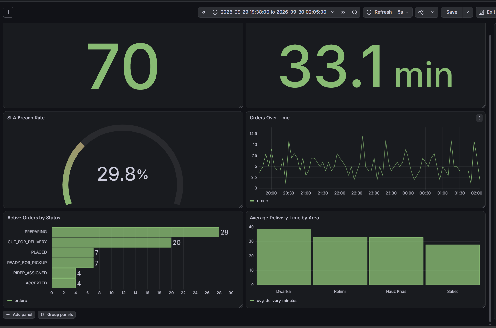

# Real-Time Food Delivery Operations Analytics

A real-time streaming analytics project that simulates food-delivery operations using **Python, Apache Kafka, PostgreSQL, and Grafana**.

The system generates synthetic order lifecycle events, streams them through Kafka, stores them in PostgreSQL, and visualizes operational KPIs in a live Grafana dashboard.

---

## Project Objective

The objective is to build an end-to-end streaming analytics system for a food-delivery business that can monitor:

- Active orders
- Delivery performance
- SLA breaches
- Demand over time
- Operational bottlenecks
- Area-wise delivery performance

---

## Dashboard



### Core KPIs and Visuals

1. **Active Orders**
2. **Average Delivery Time**
3. **SLA Breach Rate**
4. **Orders Over Time**
5. **Active Orders by Status**
6. **Average Delivery Time by Area**

---

## System Architecture

```text
Food Delivery Simulator
        |
        v
Python Kafka Producer
        |
        v
Apache Kafka
Topic: food-delivery-events
        |
        v
Python Kafka Consumer
        |
        v
PostgreSQL
order_events
        |
        v
order_summary View
        |
        v
Grafana Dashboard
```

---

## Technology Stack

| Component | Technology |
|---|---|
| Data Simulation | Python |
| Streaming Platform | Apache Kafka |
| Producer / Consumer | Python |
| Database | PostgreSQL |
| Data Transformation | SQL |
| Dashboard | Grafana |
| Containerization | Docker |
| Configuration | python-dotenv |

---

## Event Lifecycle

A simulated order can progress through the following events:

```text
ORDER_PLACED
      |
      v
RESTAURANT_ACCEPTED
      |
      v
PREPARING
      |
      v
READY_FOR_PICKUP
      |
      v
RIDER_ASSIGNED
      |
      v
PICKED_UP
      |
      v
OUT_FOR_DELIVERY
      |
      v
DELIVERED
```

Some orders can instead move to:

```text
ORDER_CANCELLED
```

Each lifecycle event is published independently to Kafka.

---

## Event Structure

Example Kafka event:

```json
{
  "event_id": "EVT-ABC123",
  "order_id": "ORD-001",
  "event_timestamp": "2026-09-30T14:30:00+00:00",
  "event_type": "ORDER_PLACED",
  "customer_id": "CUS1234",
  "restaurant_id": "RES001",
  "restaurant_name": "Spice Junction",
  "area": "Saket",
  "cuisine": "North Indian",
  "order_value": 685.00,
  "payment_method": "UPI",
  "rider_id": null,
  "estimated_delivery_minutes": 35,
  "order_status": "PLACED"
}
```

---

## PostgreSQL Design

### `order_events`

Stores every event received from Kafka.

One order can therefore have multiple rows representing different stages of its lifecycle.

### `order_summary`

A SQL analytical view that converts the event stream into one row per order.

It calculates:

- Latest order status
- Placement timestamp
- Delivery timestamp
- Promised delivery time
- Actual delivery time
- SLA breach flag
- Restaurant details
- Delivery area
- Order value

Database objects can be recreated using:

```text
database/schema.sql
```

---

## Event Time vs Processing Time

The simulator uses accelerated processing for demonstration purposes.

For example:

```text
1 simulated business minute = 0.7 real seconds
```

The events are processed quickly during the demo, while their timestamps represent realistic delivery durations.

This allows metrics such as:

- Average Delivery Time
- SLA Breach Rate

to remain meaningful while still demonstrating complete order lifecycles within a few minutes.

---

## Project Structure

```text
food-delivery-streaming/
|
|-- producer/
|   |-- producer.py
|   |-- simulator.py
|
|-- consumer/
|   |-- consumer.py
|
|-- database/
|   |-- schema.sql
|
|-- docs/
|   |-- architecture.md
|
|-- screenshots/
|   |-- live-dashboard.png
|
|-- .env.example
|-- .gitignore
|-- requirements.txt
|-- README.md
```

---

## Setup

### 1. Clone the repository

```bash
git clone <repository-url>
cd food-delivery-streaming
```

### 2. Create a virtual environment

```bash
python -m venv .venv
```

Activate it on Windows PowerShell:

```powershell
.\.venv\Scripts\Activate.ps1
```

### 3. Install Python dependencies

```bash
pip install -r requirements.txt
```

### 4. Configure environment variables

Copy:

```text
.env.example
```

to:

```text
.env
```

and update the PostgreSQL credentials if required.

### 5. Start Kafka and PostgreSQL

The application expects:

```text
Kafka      -> localhost:9092
PostgreSQL -> localhost:5432
```

### 6. Create the Kafka topic

```bash
docker exec kafka /opt/kafka/bin/kafka-topics.sh --bootstrap-server localhost:9092 --create --topic food-delivery-events --partitions 1 --replication-factor 1
```

### 7. Create the PostgreSQL schema

Run the SQL contained in:

```text
database/schema.sql
```

against the `food_delivery` database.

---

## Running the Streaming Pipeline

### Terminal 1 - Start Consumer

```bash
python consumer/consumer.py
```

The consumer listens to Kafka and continuously inserts events into PostgreSQL.

### Terminal 2 - Start Simulator

```bash
python producer/simulator.py
```

The simulator continuously creates concurrent food-delivery orders and publishes their lifecycle events to Kafka.

---

## Grafana Dashboard

Grafana connects to PostgreSQL and queries the `order_summary` view.

Recommended dashboard auto-refresh:

```text
5 seconds
```

This provides the live flow:

```text
Simulator
   |
   v
Kafka
   |
   v
Consumer
   |
   v
PostgreSQL
   |
   v
Grafana
```

---

## Analytical Insights Demonstrated

The dashboard can identify patterns such as:

- Accumulation of orders in the `PREPARING` stage
- Areas with relatively higher delivery times
- Changes in demand across simulated business time
- Current order workload
- Delivery SLA performance
- Operational bottlenecks in the delivery lifecycle

---

## Data

This project uses **synthetic simulated data**.

Synthetic data is used because real-time transactional food-delivery event streams are proprietary and are generally not publicly available.

The simulator is designed to reproduce realistic operational behavior, including:

- Concurrent orders
- Restaurant preparation delays
- Area-specific delivery delays
- Rider assignment
- Order cancellations
- SLA breaches
- Rush-period demand

---

## Security

Credentials are stored in:

```text
.env
```

The `.env` file is excluded from Git using `.gitignore`.

A safe template is provided as:

```text
.env.example
```

---

## Project Status

- [x] Event schema designed
- [x] Kafka topic configured
- [x] Python producer developed
- [x] Realistic event simulator developed
- [x] Kafka consumer developed
- [x] PostgreSQL storage configured
- [x] Analytical SQL view created
- [x] Grafana connected to PostgreSQL
- [x] Live dashboard completed
- [x] End-to-end streaming pipeline validated
